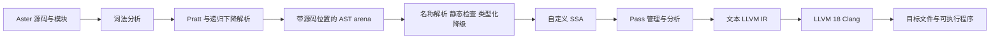

# AsterCC 实现说明

## 模块与数据流

前端保留 Token 与 AST 的稳定整数 ID。静态检查和 SSA 降级共用一次遍历：操作数类型确认后才生成相应指令，同时在 AST 上记录推断类型；`--check` 走相同语义路径，不调用 LLVM。已终止路径后的语句仍在脱离入口的块中做静态检查，最终删除这些不可达块。

编译上下文按值传递，内部 arena、符号表和游标通过明确的共享数组承载可变状态。没有使用原生指针或 C++ 对象布局来定义 Aster 的数据语义。LLVM 中结构体为聚合值，数组和字符串为受运行时管理的句柄；只有动态数组元素及运行时参数槽需要内存读写，普通可变局部变量在自定义 IR 中已经是 SSA。

## SSA 的构造约束

- `read_var(block, variable)` 缓存每块的到达定义；有单个前驱时沿前驱查找。
- 未封闭块先放置不完整 `phi`；封闭时才填入所有前驱和操作数。
- 多前驱块在递归查找前先登记自己的 `phi`，截断环上的递归。
- `while` 的 header 在 body、`continue` 的所有回边添加后封闭；exit 在全部 `break` 添加后封闭。
- 平凡 `phi` 通过替换链消除，并迭代到不再产生新替换。`&&/||` 使用分支与合流 `phi` 保留求值顺序。

SSA 验证器检查封闭状态、终结指令、返回及分支类型、算术/比较类型、`phi` 前驱覆盖与重复边、定义支配使用及块内先定义后使用。最终 LLVM IR 再由 LLVM 自身验证器检查。

## 优化合法性

所有 Pass 通过 `IR` 操作稳定 ID；替换链为使用点提供规范值。无缓存分析跨 Pass 保存，支配集合及树在需要时重新计算，避免 CFG 变化后使用陈旧结果。统计记录每个 Pass 的依赖、失效分析、变动指令数、前后规模与耗时。

SCCP 的格为 `Unknown → Constant → Overdefined`，不同常量合流为 Overdefined；控制流另维护单调增加的可执行边集合。发生值变化时只调度使用者所在块，新增可执行边时调度目标块，`phi` 只考虑可执行入边。终止性来自有限值和有限边的单调更新。

支配集合采用数据流不动点，严格支配者构成链，由其深度恢复直接支配树。GVN 按树的前序遍历函数，并用确定性哈希表查找同类型、同操作、同操作数的纯表达式；替换必须满足支配关系和块内指令顺序。不会把两次可能受存储影响的数组读取当作同一个值。

LICM 通过支配关系识别回边，反向遍历前驱构造自然循环。仅处理具有唯一、无条件入口前置块的循环；不人为猜测别名或移动内存操作。操作数已在循环外或已被外提的纯指令才能移动，依赖按固定点外提。除法、数组读取、字符串索引、分配和调用均不作投机执行。

CFG 简化先移除不可达边及块、修复 `phi`，再合并无条件跳转的单前驱后继。DCE 从终结指令和可观察操作反向标记；可能终止程序的操作即使没有使用者也保留。整型计算不添加 LLVM `nsw/nuw` 标志，除法/余数通过具有 Aster 语义的运行时原语降级。

## 自举与诊断

`bootstrap.py` 为每一级重新调用上一阶段，编译同一源码，独立生成 `.ll` 和原生 ELF。固定源文件标识、模块次序、命名和链接选项；不嵌入绝对构建路径、时间或阶段标签，关闭 ELF build-id。

逐 Pass 跟踪以“函数 ID、Pass 序号、Pass 名”命名。比较从早期构造 IR 开始；任何摘要差异都会报告首个文件，原始跟踪保存在 `build/bootstrap`，持久摘要保存在 `artifacts/trace-hashes.json`。Pass 耗时单独存放，不参与确定性比较。

独立性检查会移走种子文件，将 Stage 3 和固定运行时复制到另一个目录，再编译新 Fibonacci 程序，并检查 ELF 不依赖 `libstdc++`。这证明当前自举链的构建固定点与实际独立运行；算法正确性由另外的已知结果程序、独立整数参考计算、变换断言及 sanitizer 检查支撑。

## 成本与边界

SSA 通过按需查询避免为从未读取的局部变量插入合流值。支配集合使用矩阵，空间为 O(B²)，选择了易审查实现而非大型编译器中的压缩结构；SCCP 的执行边矩阵也为 O(B²)。GVN 使用哈希候选链；过多重复键和分支可能增加候选扫描成本。LICM 为纯运算提供有限而明确的收益，不实现 MemorySSA、别名分析、过程间常量传播或向量化。

语言和编译器全部使用进程级 arena，扩容留下的旧缓冲在退出时统一释放；适用于一次编译一次退出的运行模型。C++ 种子和 Aster 实现同源机械同步，因此它们不是两个独立设计的语义裁判。固定点不等于完整的编译器正确性证明，也不构成信任链安全证明。
