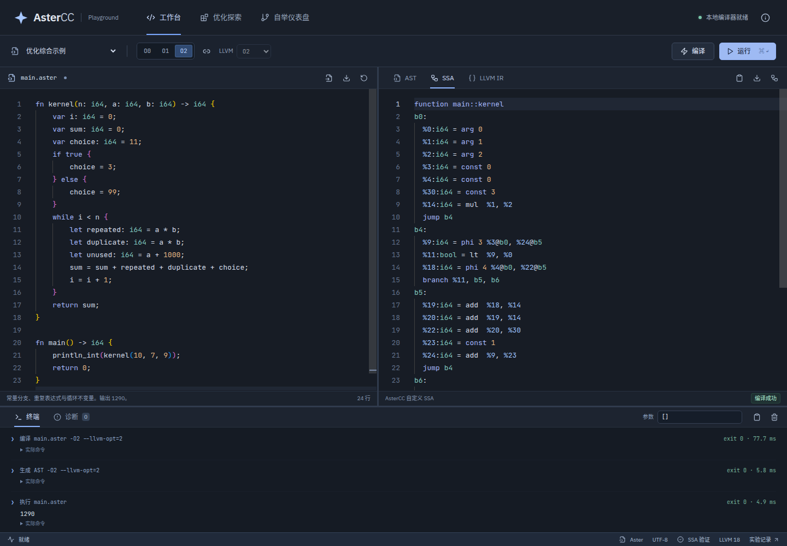
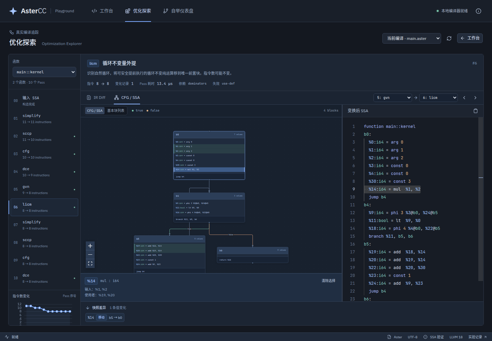
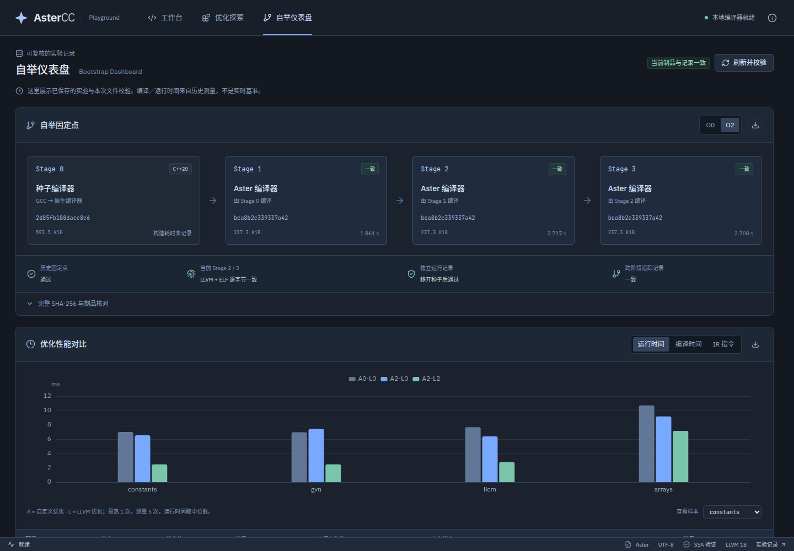

# AsterCC Playground 验证记录

2026-11-18，Asia/Shanghai。本次交付位于独立 worktree `实验三-playground`，分支 `codex/astercc-playground`，基线为 `35bdc5c`。编译器核心、原课程材料和既有实验数据未修改。

## 实际结果

| 检查 | 结果 | 证据 |
|---|---|---|
| 后端真实 Stage 3 集成 | 7 项通过 | [checks.log](checks.log) |
| 前端真实 SSA 差异 | 2 项通过 | [checks.log](checks.log) |
| TypeScript 与生产构建 | 通过 | [checks.log](checks.log) |
| 浏览器端到端交互 | 25 项通过 | [browser.json](browser.json) |
| 当前 O0/O2 Stage 1–3 制品 | 6 项与原记录一致 | [validation.json](validation.json) |
| 编译器源码来源 | 12 个文件全部与自举记录一致 | [validation.json](validation.json) |
| 一键启动 | 实际执行 `bash playground/serve.sh` 成功 | 下述复现命令 |

后端检查使用项目真实 Stage 3，覆盖 O0/O1/O2、AST/SSA/LLVM 制品、标准库、中文与 emoji 前缀的错误列转换、优化结构、非零退出、取消、执行超时、仪表盘来源与当前哈希。未模拟编译器。

浏览器检查直接操作真实编辑器及 UI：运行综合示例得到 `1290`，切换 Hello 得到 `Hello from AsterCC` 与 `45`；检查 AST/LLVM、源文件和自举 JSON 的实际下载、拖拽／键盘分栏、错误标记与跳转、LICM `%14: b5 → b0`、CFG 值关系、基本块列表、性能维度与测试筛选。检查了 1440、1024、768、390px 布局。

故障注入会主动中断一次 `/api/health` 请求，验证错误状态仍允许编辑；该阶段预期产生浏览器网络失败消息。其余检查无未预期控制台错误或未捕获异常。最终又在已连接的 Chrome 中刷新生产页面、执行综合示例并读取真实编译器版本，均成功。

## 数据真实性

当前 Stage 3 为 `AsterCC 0.1.0 (Aster SSA / LLVM 18)`，可执行文件 SHA-256：

```text
bca8b2e339337a42b3a2e4b0bab4a8a87863898b10f46caacd10174ae601e132
```

自举记录与性能样本来自原项目 artifacts。当前文件哈希在 API 请求时重新计算；历史固定点、测试和 sanitizer 结果明确作为实验记录展示。本次 Playground 验证没有重跑自举实验，也没有重写原 artifacts。

SSA 计数排除 `arg`、`const`、`string` 和终结指令，保持与编译器一致。Pass 统计中的变化记录和从快照计算的值差异分开展示。LICM 保持指令数量不变的移动经过后端及前端检查。

[validation.json](validation.json) 记录验证时间、环境入口、当前阶段哈希、编译器源码核对及新增工程源码／截图摘要。前端差异测试使用原优化实验快照解析出的固定夹具，文件内保留真实 SHA-256。

## 截图

[工作台](workbench.png) · [Pass Diff](optimization.png) · [CFG / SSA](cfg.png) · [自举仪表盘](bootstrap.png) · [手机布局](mobile.png)







## 复现

在 worktree 根目录：

```bash
bash playground/serve.sh
# 另一个终端
bash playground/check.sh
```

浏览器验收使用 `playground/tests/browser-smoke.js`，具体 Chrome 连接及运行方法见 [启动说明](../README.md#检查与展示证据)。下载验收在独立 Playwright 浏览器会话中完成。需要独立会话时可执行：

```bash
playwright-cli -s=astercc open http://127.0.0.1:8000
playwright-cli -s=astercc --raw run-code \
  --filename=playground/tests/browser-smoke.js
```

## 当前边界

支持单文件与现有标准库；终端是原生程序输出视图，不是交互式 PTY。编译任务索引在服务重启后重建，磁盘制品保留。自举仪表盘只读，不启动整套实验。

Monaco 完整编辑器引入约 4.36 MB 的主 JavaScript 包，生产构建会报告包大小提示，构建正常完成；图表、优化探索和仪表盘按需加载。优先保留稳定的编辑器服务注册，未通过修改编译器或移除展示能力缩减依赖。
